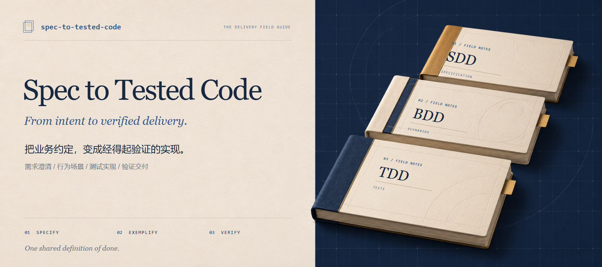
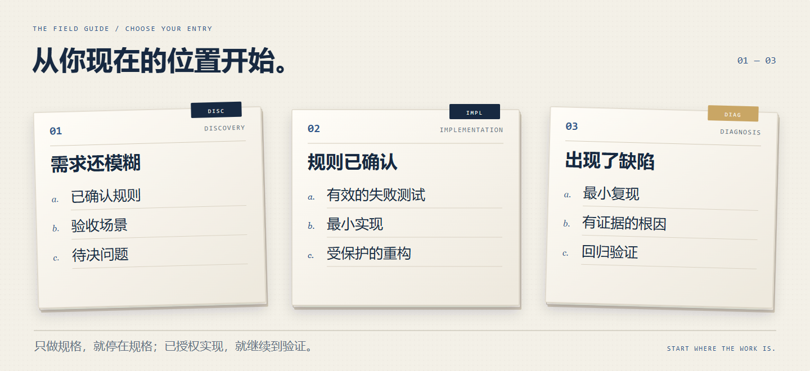
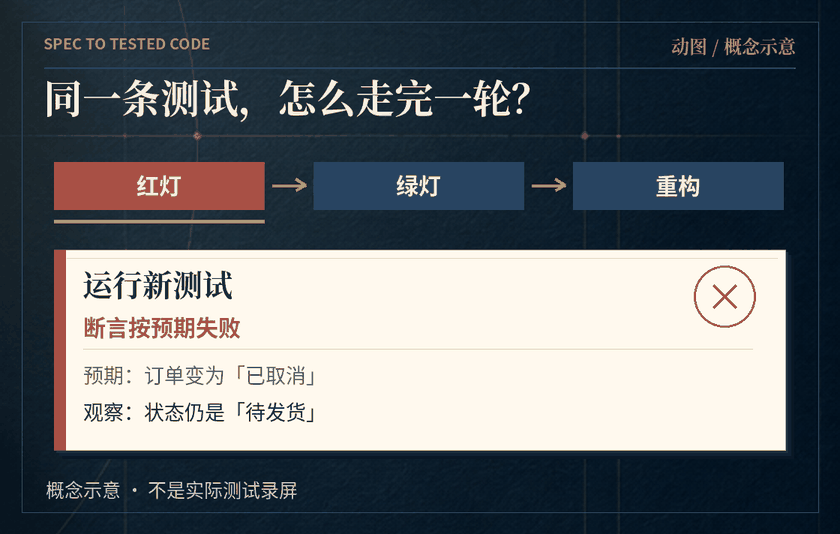
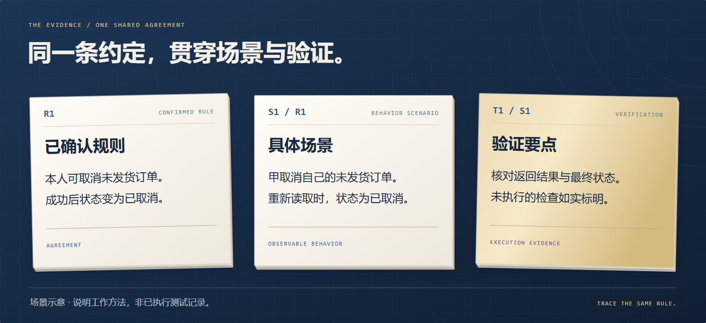

<p align="center">
  
</p>

<p align="center">
  <picture>
    <source media="(prefers-color-scheme: dark)" srcset="assets/readme/format-and-install-dark.svg">
    
  </picture>
</p>

# Spec to Tested Code

**把业务约定，变成经得起验证的实现。**

一个串联需求规格、行为场景与测试驱动实现的 Agent Skill。它让需求澄清、计划、排障、评审和交付验证围绕同一组业务约定展开，并让完成声明对应到实际证据。

[安装](#安装) · [第一次使用](#第一次使用) · [贯穿一个例子](#贯穿一个例子) · [可运行示例](#可运行示例) · [行为评测](#行为评测) · [工作说明](#工作说明)

## 安装

准备 Node.js、npm/npx 与 Git。在希望安装技能的位置运行：

```sh
npx skills add Annabelle0726/spec-to-tested-code --skill spec-to-tested-code -g
```

按提示选择使用技能的工具。`-g` 表示用户级安装，省略它则安装到当前项目。运行环境要求以 [skills CLI 官方说明](https://github.com/vercel-labs/skills#install-a-skill)为准；本项目无需单独发布 npm 包。

<details>
<summary>本地安装、查看可用技能与更新</summary>

在本仓库根目录安装本地源码：

```sh
npx skills add . --skill spec-to-tested-code
```

仅查看远程仓库提供的技能：

```sh
npx skills add Annabelle0726/spec-to-tested-code --list
```

从远程来源安装后，通过管理器检查或更新：

```sh
npx skills check
npx skills update
```

检查或更新可能包含其他已跟踪的技能，按提示选择。安装后让宿主重新加载技能。更多细节见[安装说明](docs/installation.md)。

</details>

## 第一次使用

给它一个小需求，先把“怎样算完成”写清楚：

```text
用 $spec-to-tested-code 梳理“用户取消未发货订单”的已确认规则、
验收场景和待决问题，先不编码。
```

它会区分有依据的规则、实现现状、建议和待决问题，为确认的规则配上具体场景。没有约定的退款、库存回补等行为会作为问题保留。

<picture>
  <source media="(max-width: 600px)" srcset="assets/readme/entry-points-mobile.png">
  
</picture>

已有明确规则并要求实现时，可以直接进入测试先行；只要规格或评审时，交付停在相应阶段。流程深度随任务需要调整。

## SDD、BDD、TDD 怎样配合

**SDD · 先确立约定。** 这里指 Specification-Driven Development。写清谁在什么条件下可以对什么对象做什么，以及应当产生什么结果。实现与现行规格冲突时，记录差异和依据。

**BDD · 用例子形成共同理解。** 把规则写成可观察的场景，让产品、开发和测试能独立判断是否通过。可以用“给定／当／则”或紧凑表格，无需强制引入 Gherkin 框架。

**TDD · 用测试逐步实现。** 为一个已确认行为写有效测试，实际观察预期失败，再完成最小实现与重构。最后执行相关回归，并报告真正验证过的结果。

<p align="center">
  
</p>

动图为红—绿—重构的概念示意；实际可执行的验证见下方[可运行示例](#可运行示例)。

澄清和计划确定工作范围；排障和评审检查差异；交付时把规则、场景、测试和证据对齐。

## 贯穿一个例子

下面以订单取消说明工作方法。完整教学约定以 [示例规格](examples/order-cancellation/SPEC.md) 为准；附带的内存示例可以运行，但不构成生产订单系统或线上验收证据。

<picture>
  <source media="(max-width: 600px)" srcset="assets/readme/rule-to-evidence-mobile.png">
  
</picture>

### 已确认规则

**R1：** 订单所有者可取消尚未发货的订单，成功后订单状态变为“已取消”。**R2：** 非所有者取消时拒绝，订单不变。**R3：** 已发货订单取消时拒绝，订单不变。以上为教学样例中明确确认的规则。

### 验收场景

**S1，关联 R1：** 给定甲拥有一笔尚未发货的订单；当甲取消它；则操作成功，甲重新读取订单时看到状态为“已取消”。

**S2，关联 R1：** 换另一位所有者与不同订单，成功结果仍成立，避免只对固定样例返回正确结果。

**S3，关联 R2：** 给定乙不拥有甲的订单；当乙尝试取消它；则操作被拒绝，订单状态保持不变。

**S4，关联 R3：** 给定甲的订单已发货；当甲尝试取消它；则操作被拒绝，订单状态保持不变。

### 待决问题

取消是否触发退款和库存回补？同一请求重试应返回原结果还是拒绝重复？这些答案会改变额外场景的预期，需要确认后再写入必过测试。

### 实现与验证

真实项目中，应为这些场景选择能检验权限接线和状态持久化的测试边界。附带示例只检查内存对象上的决策与状态变化；数据库集成测试没运行，就明确写“持久化行为尚未验证”。退款、库存回补和并发语义未确认时，不把它们放进已授权的交付切片。

## 可运行示例

有 Python 3.10+ 即可在项目根目录执行，无须安装第三方依赖：

```sh
python -B examples/order-cancellation/demo.py
```

同一组四个测试先检查保留的不完整起点，再检查完成后的实现：预期先出现四项断言失败，再四项通过。脚本在临时目录运行，不覆盖源码；环境错误、跳过或零测试不能充当成功的红绿验证。单独运行最终测试及示例边界见 [运行说明](examples/order-cancellation/README.md)。

## 行为评测

技能评测关注执行者是否遵守用户范围、区分环境阻塞与行为失败，以及保留未确认的业务问题；它与上面的业务单元测试分别验证。

```sh
python -B evals/prepare.py
```

该命令只准备四组独立项目和技能快照，不会调用模型。把各组请求交给独立执行者后，再结合回复、实际命令、文件哈希与代码差异判定。方法和判定标准见 [评测说明](evals/README.md)；已执行的结果和未覆盖内容见 [验证记录](evals/results/2026-11-17.md)。

## 根据任务调用

**从确认过的规则开始实现：**

```text
用 $spec-to-tested-code 按已确认的订单取消规则实现，
先写能检出错误行为的测试，再完成实现、重构和相关回归。
```

**从异常开始排查：**

```text
用 $spec-to-tested-code 排查重复取消导致库存增加两次的问题，
先定位根因，再补回归测试并验证修复。
```

**在交付前评审：**

```text
用 $spec-to-tested-code 检查这次改动是否满足已确认场景，
核对测试证据，并指出尚未验证的边界。
```

## 保持流程适度

- 沿用项目术语、规格位置、测试框架和工作目录，保护现有改动。
- 只问会改变范围或验收结果的问题，继续推进不依赖待决答案的部分。
- 规格、场景和测试保持对应，不把实现现状自动当成正确规则。
- 不强制新建 worktree、启动子代理、逐步审批或每步提交。
- 文案、静态样式和机械配置修改按实际风险验证，无需强行制造失败测试。
- 已有代码逐步补上有效测试；不会因为测试写晚了就删除用户实现。
- 明确规格下的实现缺陷在已有授权内处理；只评审、只诊断的请求停在相应阶段。
- 默认复用项目命令；浏览器、文档检索和远端检查按需使用，不要求额外安装 MCP。

## 工作说明

入口为 [SKILL.md](SKILL.md)，详细说明按任务读取：

| 说明 | 使用时机 |
| --- | --- |
| [规格与场景](references/specification.md) | 建立规则、编写例子、记录冲突和待决问题 |
| [澄清、计划与执行](references/planning.md) | 澄清关键取舍，拆分可验证的交付切片 |
| [测试驱动实现](references/testing.md) | 选择测试边界，执行红绿重构与回归 |
| [根因排查](references/debugging.md) | 复现异常、验证假设、定位故障 |
| [评审与收尾](references/review.md) | 核对规格符合性、代码质量和最终验证证据 |

这是给支持 Agent Skills 的工具使用的工作说明，没有独立应用服务。实际检查依赖目标项目的工具、权限与运行环境；技能本身不替代业务决策，也不保证每个场景都可自动化。

## 许可证

采用 [Apache License 2.0](LICENSE)。
